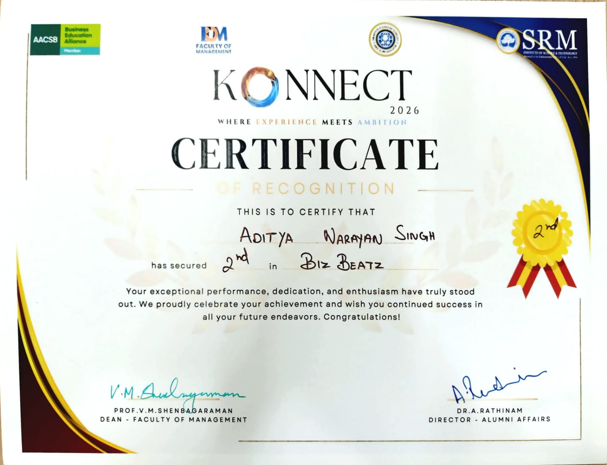
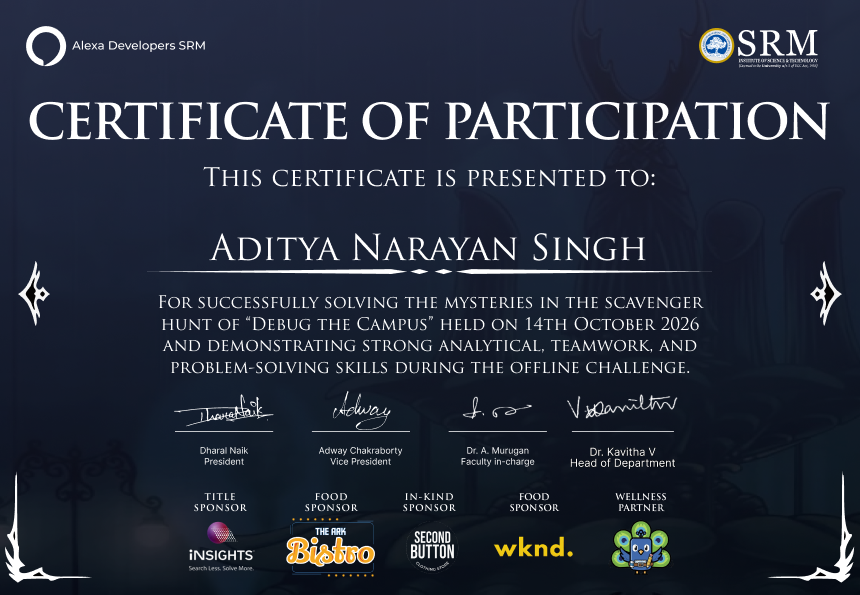

# Achievements & Certificates

A visual record of my achievements, certifications, awards, and milestones in
competitions and learning.

---

## 🏆 Featured Achievement

### Konnect 2026 — Biz Beats

| Detail | Information |
| --- | --- |
| **Result** | Secured **2nd position** |
| **Competition** | Biz Beats |
| **Event** | Konnect 2026 |
| **Institution** | SRM Institute of Science and Technology, Kattankulathur |
| **Recognition** | Certificate of Recognition |

### Debug the Campus — Certificate of Participation

| Detail | Information |
| --- | --- |
| **Event** | Debug the Campus |
| **Date** | 14 October 2026 |
| **Recognition** | Certificate of Participation |
| **Achievement** | Successfully solved the scavenger hunt and demonstrated analytical, teamwork, and problem-solving skills during the offline challenge |

### Rocketry Workshop and Competition — Certificate of Participation

| Detail | Information |
| --- | --- |
| **Event** | Rocketry Workshop and Competition |
| **Program** | World Space Week 2026 |
| **Organizer** | Department of Aerospace Engineering, SRM Institute of Science and Technology, Kattankulathur |
| **Date** | 4–10 October 2026 |
| **Recognition** | Certificate of Participation |

[Rocketry Workshop and Competition certificate](rocketry-workshop-9-october-certificate.pdf)
